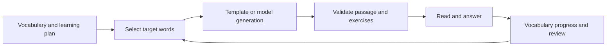

# English Reading · Practice Your Vocabulary Through Reading

[简体中文](README.md) | [English](README.en.md)

Choose a vocabulary book and learning goal, generate an English passage containing those words, then complete comprehension questions, cloze exercises, and vocabulary self-assessments. Learn words in context and continue practicing according to familiarity and review timing.

This is a full-stack Next.js application. Start with the key-free template mode to try the complete workflow, then connect DeepSeek for generation. Learning data lives in the running server's `data/` directory; the application is suited to personal local use.

[Try it](#start-in-template-mode) · [First passage](#generate-your-first-passage) · [Import words](#import-your-own-vocabulary-book) · [Real models](#switch-to-a-real-model) · [Storage](#where-learning-records-are-stored)

## Start in template mode

Node.js 22 and npm are suggested. In Windows PowerShell:

```powershell
git clone https://github.com/kayaduster607-jpg/english_reading.git
cd english_reading
npm install
$env:AI_PROVIDER = "mock"
npm run dev
```

Open [http://localhost:3000](http://localhost:3000). Dependency installation may need network access; mock mode makes no model calls. Template mode demonstrates input, exercises, and saving; its passages do not represent real model generation quality.

## Generate your first passage

1. Open `/settings`, choose an exam goal, active vocabulary book, and learning plan, then save. You can begin with a built-in book.
2. Open `/today`, enter `technology` as the topic, choose the book for this passage, and set the target word count. Start with 8–24 target words to avoid overcrowding the first passage.
3. Click “生成今日阅读” (generate today's reading), wait for generation and validation, and read the passage. Check target-word meanings in context.
4. Answer the comprehension and cloze questions, then submit vocabulary familiarity: unknown, uncertain, familiar, or mastered.
5. Open history and review pages to inspect passages, answers, and word states. Pay attention to overwrite confirmation when regenerating today's passage.

| Input | Output | Next use |
| --- | --- | --- |
| Vocabulary book, topic, difficulty, and words per passage | English passage, target words, reading guidance / translation | Read in context |
| Answers | Comprehension and cloze feedback | Check understanding |
| Word familiarity and exercise feedback | State, correct / incorrect counts, next review time | Future word selection and review |

Results appear on the website and are saved to server files; Word or PDF files are not downloaded automatically. A complete round includes generation, answering, feedback submission, and checking saved records—not just clicking Generate.

## Import your own vocabulary book

Upload TXT, CSV, Excel, or a text-layer PDF at `/vocab`, check and edit the preview, then confirm import. Start with this small UTF-8 CSV sample:

```csv
word,meaning,pos,example
retrieve,检索,v.,Retrieve relevant documents.
context,上下文,n.,Use the context to answer.
evidence,证据,n.,Check the evidence first.
```

`word` and `meaning` are required; `pos` and `example` are optional. Each TXT line needs at least an English word and a meaning, separated by a tab, pipe, or comma. Check recognition results for complex PDFs, scans, and mixed-layout tables. Seeing the preview does not mean the book has been saved.

An AI-assisted extraction route exists when rule-based parsing fails, but availability depends on model configuration. Do not assume mock mode can handle arbitrary scans or complex layouts.

## Switch to a real model

Stop the development server, set process variables in the same terminal, and restart:

```powershell
$env:AI_PROVIDER = "deepseek"
$readingKey = Read-Host "DeepSeek API Key" -AsSecureString
$env:DEEPSEEK_API_KEY = [System.Net.NetworkCredential]::new("", $readingKey).Password
npm run dev
```

`DEEPSEEK_MODEL` can select a model your account can actually call. Defaults come from project code; service access depends on your provider account. Keep keys server-side and out of frontend code and Git.

Real generation reports stage progress over SSE, then validates passage length, target-word coverage, and question structure, retrying failures. An accessible page does not prove a model request succeeded; check the specific generation-stage message.

## Why the next passage chooses different words

The selection service combines new words, weak words, due reviews, and recent exposure, lowering the priority of recently seen words and excluding mastered ones. Generation records only that a word appeared. Exercise counts, familiarity, state, and next review time update after self-assessment is submitted.



A word appearing in a passage and a word being mastered are different states. Learning still requires answers and feedback.

## Where learning records are stored

Vocabulary books use metadata and entry files. Passages, learning plans, and progress live in the server's `data/` directory. The current implementation centers on a default local user and lacks complete multi-account isolation; do not expose it directly as a public multi-user service.

Stop writes before backing up the whole `data/` directory; saving a browser page is insufficient. Generation cleans up readings older than 15 days, so save important passages elsewhere promptly. Moving the working directory or server instance requires an explicit data migration.

## Common issues

| Symptom | Check |
| --- | --- |
| Model requests occur without a key | Set AI_PROVIDER=mock in the same terminal that starts npm |
| Custom book is missing | Confirm the import after preview and switch the active book |
| Reading finished but progress is unchanged | Submit exercise or vocabulary feedback rather than just viewing the passage |
| Port 3000 is occupied | Use the actual port printed by Next.js |
| Installation / generation fails | Record the original dependency or service error; installation duration is not a fixed promise |

Development and production commands are in `package.json`: `npm run dev`, `npm run build`, and `npm run start`. Code defines versions and behavior; historical plans are not listed here as completed capabilities.
